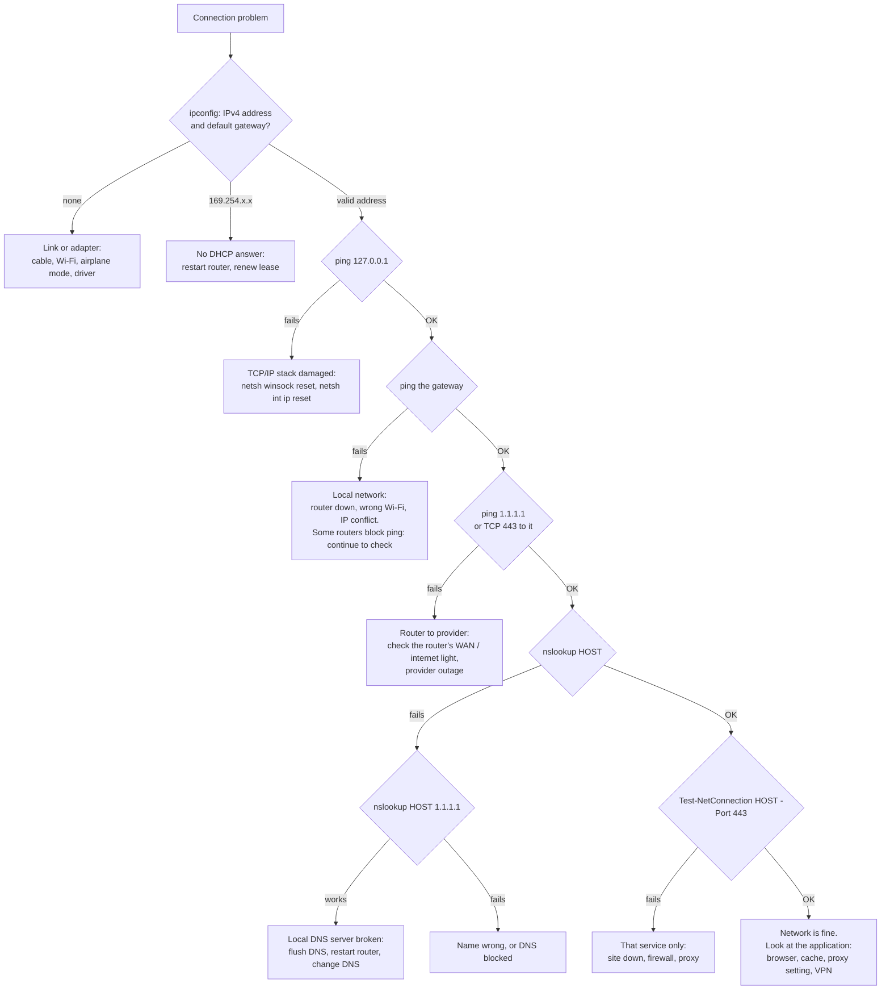

# Windows network diagnostics toolkit

Three batch scripts and a decision tree for finding out **where** a Windows PC's connection is broken, on any home or small-office network.

**Problem it solves:** "the internet is down" can mean a loose cable, a failed DHCP lease, a dead router, a provider outage, a broken DNS server or one unreachable website. Each has a different fix, and guessing wastes time. Testing the layers in order, bottom up, finds the broken one in a minute.

## Files

| Script | What it does | Changes settings? |
|---|---|---|
| `netcheck.bat [HOST]` | Tests six layers in order and stops at the first failure, with a verdict and a next step. Exit code = number of the failed layer (0 = all OK) | No |
| `netreport.bat [HOST]` | Saves the output of eleven standard diagnostic commands into `reports\netreport_<timestamp>.txt` | No |
| `network-reset.bat` | Menu of the three standard fixes, least disruptive first: flush DNS, renew the DHCP lease, reset Winsock and TCP/IP. Needs administrator rights and asks before the full reset | **Yes** |

`HOST` defaults to `www.msftconnecttest.com`, the host Windows itself probes to decide whether it's online (the check behind the "No internet" icon). A reserved name like `example.com` would be a poor default: some routers' DNS servers refuse it, and the check would then blame DNS on a network where it works.

> **Privacy:** a `netreport` file contains the PC's name, MAC addresses, local IPs and Wi-Fi network name. Keep it for your own comparison, and redact it before sharing it with anyone. `reports/` is git-ignored.

## Example

```
C:\> netcheck.bat
Network check - target www.msftconnecttest.com

[OK] 1. Local address 192.168.1.23, default gateway 192.168.1.1
[OK] 2. TCP/IP stack answers on 127.0.0.1
[OK] 3. Gateway 192.168.1.1 answers
[OK] 4. Internet reachable by IP (ping 1.1.1.1)
[FAIL] 5. The configured DNS server fails, but 1.1.1.1 resolves www.msftconnecttest.com.
       Next: run "ipconfig /flushdns", restart the router, or set a different DNS server.
```

Here the connection works up to the internet. Only name lookup through the router fails, so the fix is DNS: rebooting the PC or reinstalling the network driver wouldn't help. *(Addresses in this example are illustrative.)*

## Decision tree

The same logic `netcheck.bat` follows, for working through a problem by hand:



Text version:

```
1. ipconfig            no address           -> link/adapter (cable, Wi-Fi, driver)
                       169.254.x.x          -> DHCP failed (restart router, renew lease)
2. ping 127.0.0.1      fails                -> TCP/IP stack (winsock/IP reset)
3. ping <gateway>      fails                -> local network (router, Wi-Fi, IP conflict)*
4. ping 1.1.1.1        fails (and TCP 443)  -> router-to-provider link or outage
5. nslookup HOST       fails, but works via 1.1.1.1 -> local DNS server
                       fails both ways      -> wrong name or DNS blocked
6. TCP 443 to HOST     fails                -> that service, a firewall or a proxy
   all pass                                 -> the problem is in the application, not the network
* some routers ignore ping; if later steps pass, the gateway is fine
```

## How `netcheck.bat` works

- **Gateway and address** come from the IPv4 routing table (`route print -4 0.0.0.0`): the first route to `0.0.0.0/0` gives the gateway and the local interface address. The table is numeric, so this works on any display language. `ipconfig`'s labels, like "Default Gateway" or "Passerelle par défaut", are translated.
- **Ping success** is detected by looking for `TTL=` in the replies, not by `ping`'s exit code. `ping` can return 0 when a router answers "Destination host unreachable", which isn't a real reply.
- **ICMP blocked is not "offline".** If `ping 1.1.1.1` fails, the script also tries a TCP connection on port 443 before declaring the internet unreachable, because some networks drop ping.
- **DNS gets a second opinion.** A failed lookup is retried against a public resolver, `1.1.1.1`. That splits "the local DNS server is broken" from "the name doesn't exist or DNS is blocked".
- TCP and DNS tests use PowerShell's `Test-NetConnection` and `Resolve-DnsName`, which return a clean success or failure instead of text to parse.

## Notes / Lessons Learned

- Test bottom up and change one thing at a time. Resetting everything at once can fix the symptom but hides the cause, and the problem comes back.
- `find` in a batch file can be shadowed by the Unix `find` that tools such as Git put on the PATH. `findstr` has no Unix twin, so the scripts use it.
- `netsh int ip reset` rewrites the TCP/IP settings of every adapter, including static IPs. `network-reset.bat` warns before it runs, and `netreport.bat` is a quick way to record the old settings first.
- Wi-Fi problems often sit below IP: `netsh wlan show interfaces` shows signal strength, band and link rate. The report includes it.

- **Testing status:** `netcheck.bat` and `netreport.bat` were run on a real Windows PC. `network-reset.bat` was tested only as far as its administrator check; its three fixes have not been run.
